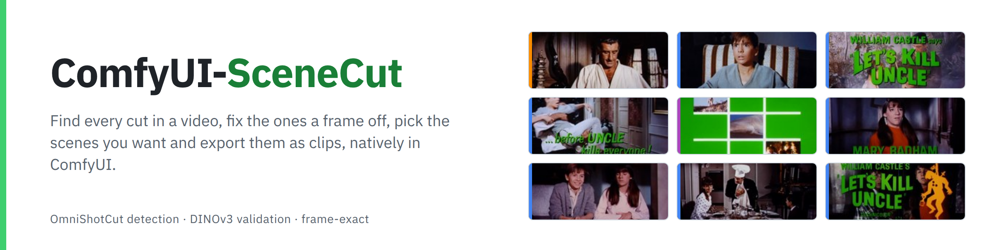
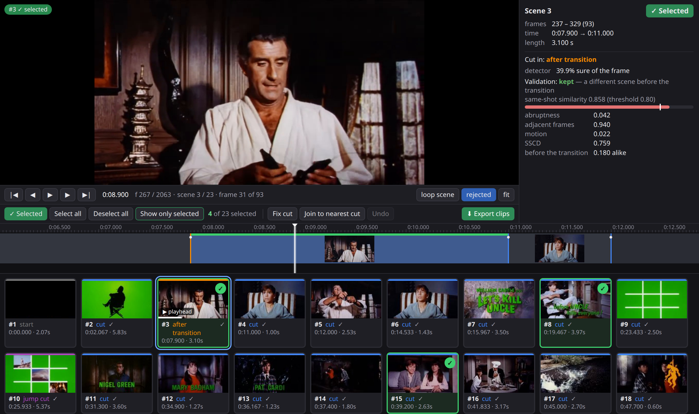
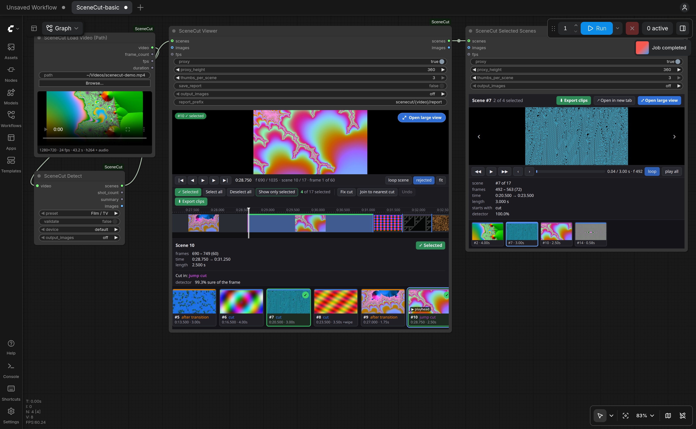

<picture>
  <source media="(prefers-color-scheme: dark)" srcset="assets/banner-dark.png">
  
</picture>

<p align="center">
  
  
  
  
</p>

<p align="center">
  <a href="https://pedromarinhodev.github.io/ComfyUI-SceneCut/"></a>
  <a href="#quick-start"></a>
  <a href="example_workflows"></a>
</p>

Find every shot in a video, **natively in ComfyUI**: **[OmniShotCut](https://github.com/UVA-Computer-Vision-Lab/OmniShotCut)**
finds the cuts and labels the transitions, **DINOv3** checks every cut so a camera flash or a whip pan doesn't split a shot,
and a viewer in the node lets you review the result: play it, step frame by frame, move a cut that is a frame off, pick
the scenes you want and **export them as clips**, cut on the exact frames, with their sound. Every stage is frame-exact:
frame *n* is the *n*-th decoded frame, never a seek that lands next to it.

<a href="https://pedromarinhodev.github.io/ComfyUI-SceneCut/#demo"></a>

<sub>The SceneCut Viewer on the trailer of William Castle's <i>Let's Kill Uncle</i> (1966, public domain): 23 scenes, four
selected, scene 3 inspected (a cut after a dissolve, kept by validation). Blue: cut, purple: jump cut, orange: after a
transition, green: selected. Click to try it in your browser.</sub>

<table>
  <tr>
    <td width="33%"><br><b>Every shot, labelled</b><br>Hard cuts, jump cuts, and dissolves, wipes, pushes, slides, zooms and fades, with presets for film, music videos, anime, vlogs and sports.</td>
    <td width="33%"><br><b>Every cut checked</b><br>Flashes, strobes, fast pans and a shot split in two are merged back. Each decision keeps its scores; nothing is thrown away.</td>
    <td width="33%"><br><b>Fix a cut in one click</b><br>Playhead on the wrong frame, <b>Fix cut</b>: the cut moves to where the picture really changes.</td>
  </tr>
  <tr>
    <td><br><b>Pick your scenes</b><br>Select in the viewer, play the selection scene by scene in its own node or browser tab, kept in sync.</td>
    <td><br><b>Export clips</b><br>One file per scene with its sound, plus <code>scenes.json</code>. H.264, H.265, NVENC, ProRes or lossless FFV1.</td>
    <td><br><b>Plug into any workflow</b><br>Scenes out as <code>IMAGE</code> batches, images in as one scene, scene lists as JSON, and a core that runs without ComfyUI.</td>
  </tr>
</table>

## Quick start

1. **Install the nodes** and restart ComfyUI. Search for **SceneCut** in ComfyUI-Manager, or install it from the [Comfy Registry](https://registry.comfy.org/nodes/scenecut) with `comfy node install scenecut`. The Manager installs the two small
   requirements too. Or clone into `custom_nodes` and install them yourself:

   ```bash
   cd ComfyUI/custom_nodes
   git clone https://github.com/PedroMarinhoDev/ComfyUI-SceneCut
   pip install -r ComfyUI-SceneCut/requirements.txt
   ```

2. **Open the workflow.** Templates → custom nodes → **SceneCut-basic**, or drag
   [`example_workflows/SceneCut-basic.json`](example_workflows/SceneCut-basic.json) into ComfyUI. Pick a video with
   **Browse...** on the Load Video node; a small player previews it.

3. **Queue it, then review.** The models download on first use (below). When the run ends, the viewer shows every scene:
   fix cuts, select scenes and press **Export clips**. The clips go to `output/scenecut/<video>/scenes_00001/`.



The workflow is **SceneCut Load Video → SceneCut Detect → SceneCut Viewer → SceneCut Selected Scenes**. Nothing is saved
until you press Export; your fixes and selection are stored with the workflow and applied to the viewer's output, so nodes
after it work on the reviewed, selected scenes.

## Models

They download the first time they are needed, into your ComfyUI models folder, and are checked against their SHA-256.

| File | Folder | Size | Used for | License |
|---|---|---|---|---|
| [`OmniShotCut_ckpt.pth`](https://huggingface.co/uva-cv-lab/OmniShotCut) | `models/scenecut` | 164 MB | detection | MIT |
| [`dinov3_vitl16_pretrain_lvd1689m.safetensors`](https://huggingface.co/facebook/dinov3-vitl16-pretrain-lvd1689m) | `models/clip_vision` | 1.2 GB | validation | DINOv3 License |
| [`sscd_disc_large.torchscript.pt`](https://github.com/facebookresearch/sscd-copy-detection) | `models/scenecut` | 178 MB | validation tie-breaks (optional) | MIT |

DINOv3 comes from Meta's repository when you have accepted its license there and are logged in (`hf auth login`);
otherwise from a mirror holding the byte-identical file. To install it by hand, save the repository's
`model.safetensors` under the name above.

## Reviewing

The **SceneCut Viewer** shows the scene list inside the node: a player on a small H.264 copy of the video (made once and
cached, so any source plays and seeks quickly), a zoomable timeline with every cut coloured by kind and the cuts that
refinement or validation removed on a lower track, a panel with the scene's details and the validator's evidence, and a
card per scene. **Open large view** puts it over the whole window.

- **Fix cut** (`A`): put the playhead on a frame on the wrong side of a cut, say the first frame of a scene still shows the
  previous shot. The frames around the cut are compared with both scenes and with each other, and the cut moves to where
  the picture changes. A cut that ends a dissolve, wipe or fade has no such frame: move it with Join to nearest cut.
- **Join to nearest cut** (`M`): the frame under the playhead, and any frames between it and the nearest cut of its scene,
  move to the scene on the other side. **Undo** with `Ctrl+Z`.
- **Select**: the circle on a card, `S`, `Ctrl`+click, or `Shift`+click for a range; **Select all**, **Deselect all**,
  **Show only selected** (`O`).
- **Export clips** (`E`): see below.

Keys with the viewer focused: `Space` play, `←` `→` one frame, `↑` `↓` previous and next cut, `L` loop the scene, `R`
removed cuts on and off, `F` fit the whole video. Over the timeline the wheel zooms and `Shift`+drag pans; elsewhere on the
node, `Ctrl`+wheel zooms the canvas and `Ctrl`+drag moves it.

**SceneCut Selected Scenes** plays the selection one scene at a time: arrows on the video or the arrow keys move between
scenes, with each scene's details beside it. Connected to a viewer it follows the selection as you make it; **Open in new
tab** gives it a page of its own, kept in sync with the node.

## Exporting clips

**Export clips** in the viewer or in Selected Scenes writes one file per scene and `scenes.json` (the scene list with your
selection and fixes, and a table of the clips) to a new folder, in the background, with a progress bar:

```
output/scenecut/<video>/scenes_00001/
  <video>_002.mp4  <video>_005.mp4  ...    named after the scene numbers
  scenes.json
```

Each clip holds exactly its scene's frames and the sound between its first frame and the next scene's. Frames are found by
their timestamps, so a scene in the middle of a long film is one keyframe seek away. The **SceneCut Save Scenes** node does
the same inside a workflow, for the selected scenes when a viewer selected some.

| Codec | File | Encodes on | Use it for |
|---|---|---|---|
| **H.264** (default) | `.mp4` + AAC | CPU | plays everywhere |
| H.264, NVIDIA GPU | `.mp4` + AAC | GPU (NVENC) | the same, faster |
| H.265 / HEVC, 8 or 10-bit | `.mp4` + AAC | CPU | smaller files |
| H.265, NVIDIA GPU | `.mp4` + AAC | GPU (NVENC) | smaller files, fast |
| ProRes 422 HQ | `.mov` + PCM | CPU | editing |
| FFV1 | `.mkv` + FLAC | CPU | lossless, for datasets |

Quality is `high` (visually lossless), `medium` or `small`. Everything runs on PyAV, which ships with ComfyUI: no
ffmpeg binary needed.

## Nodes

| Node | |
|---|---|
| **SceneCut Load Video (Path)** | Any video on disk → `VIDEO`, frame count, fps, duration. **Browse...** picks a file on the machine ComfyUI runs on; a small player previews it |
| **SceneCut Detect** | `VIDEO` + preset (+ validate, device) → scene list, shot count, summary |
| **SceneCut Viewer** | Review, fix cuts, select scenes, export; outputs the reviewed scene list |
| **SceneCut Selected Scenes** | Plays the selected scenes one at a time; own browser tab; export |
| **SceneCut Contact Sheet** | Pages of thumbnails, one tile per scene, coloured by cut type |
| **SceneCut Save Scenes** / **Load Scenes** | Clips + `scenes.json` to the output folder / a scene list back from its folder or file |
| *advanced* **SceneCut Detector Loader** | Checkpoint and device |
| *advanced* **SceneCut Detect (Advanced)** | Raw detector output: window overlap, confidence floor, batching, decoder |
| *advanced* **SceneCut Refine** | Transition handling, minimum shot length, cut snapping, fragment clean-up |
| *advanced* **SceneCut Validator Loader** | DINOv3 file, SSCD on or off, fp32 or bf16, device |
| *advanced* **SceneCut Validate (Advanced)** | Window, flash sensitivity, adaptive or fixed threshold, feature weights, guards |

Each stage is cached by ComfyUI, so tuning Refine or Validate never runs detection again; within Validate, threshold and
guard changes are instant. Every node that outputs scenes also has an `images` output, set by `output_images`: all frames,
or the first or middle frame of each scene, from the selected scenes. The viewers and the contact sheet take `images`
(+ `fps`) instead of a scene list, as one scene.

## Presets

| Preset | For | Minimum shot | Flash sensitivity |
|---|---|---|---|
| Film / TV | measured pacing, dissolves, few flashes | 0.40 s | 15 |
| Music video / fast edit | beat cuts, strobes | 0.17 s | 12 |
| Anime / animation | held frames, impact flashes, fades | 0.25 s | 10 |
| Vlog / talking head | jump cuts in one setup | 0.50 s | 15 |
| Sports / broadcast | fast pans, graphic wipes; keeps transitions as segments | 0.30 s | 18 |

Durations are in seconds, so a preset means the same at any frame rate. Film and Music video are tuned on real footage;
the others start from reasoned values, and feedback on them is welcome.

## How validation works

For each cut, DINOv3 embeds the frames on both sides: a global vector and a 7×7 grid of patch vectors per frame. The cut
is scored on how similar the two sides are, how abruptly the picture changes at the cut, camera motion, a colour histogram,
and whether a brightness spike that returns to its baseline (a flash) sits on it. A per-video threshold separates "same
shot" from "cut", and SSCD, a copy-detection descriptor that ignores lighting, breaks close calls. A cut kept beside a
flash goes between the frames that look like each shot. A cut that ends a dissolve or fade is also compared with frames
from before the transition: the frames just before it already show the next shot, so they alone would call it the same
shot. Validation reads only the frames near cuts, in one pass, so memory stays flat however long the video.

## Requirements

| | Minimum | Tested |
|---|---|---|
| GPU | none (CPU works, slowly: DINOv3 runs at ~5 frames per second); 4 GB of VRAM with an NVIDIA GPU | RTX 4090 and RTX 3090 |
| ComfyUI | v0.39 | v0.39.0 and v0.41.0, frontend 1.53 and 1.55, classic and Nodes 2.0 |
| System RAM | 8 GB | 188 GB |
| ffmpeg | not needed; a binary on the PATH makes detection a little faster | |
| OS | | Linux |

## Performance

RTX 4090 and Intel Core i9-14900K, measured on 2026-10-16. "End to end" is the basic workflow: detection, validation,
and the viewer's preview copy and thumbnails. Export writes every scene with its sound, H.264 at quality `high`, on the
CPU; every clip was checked to hold exactly its scene's frames.

| Video | End to end | Export all scenes |
|---|---|---|
| 2 min, 1920×1080, 30 fps (50 scenes) | 17 s | 29 s |
| 6.5 min, 2560×1080, 24 fps (223 scenes) | 63 s | 139 s |

H.264 on the NVIDIA GPU exported the 2-minute film in 24 s: at this size decoding, not encoding, sets the pace. **Fix
cut** takes about 0.2 s: it reads only the frames around the cut, from the preview copy.

## Without ComfyUI

The `scenecut` package has no ComfyUI imports, and `scenecut.headless` runs the same pipeline as **SceneCut Detect** from a
script. It needs `torch`, `av`, `numpy`, `safetensors`, `huggingface_hub` and, for validation, `transformers` (DINOv3 is
loaded into Hugging Face's module from the same weights file).

```python
import sys; sys.path.insert(0, "/path/to/ComfyUI-SceneCut")
from scenecut.headless import Models, run
from scenecut.export import write_export

models = Models.load("/path/to/ComfyUI/models", device="cuda")    # scenecut/ and clip_vision/ inside
scenes = run("film.mp4", "film", models)                           # a SceneList; scenes.to_dict() is the JSON
write_export(scenes, range(len(scenes.segments)), "film_scenes/")  # the clips and scenes.json
```

## Scene list format

```json
{ "format": "scenecut.scenes", "version": 1,
  "source": { "path": "...", "fps": "30000/1001", "frame_count": 7153, "width": 1920, ... },
  "segments": [
    { "start": 0, "end": 75, "kind": "shot" },
    { "start": 75, "end": 130, "kind": "shot",
      "cut": { "frame": 75, "relation": "hard_cut", "confidence": 0.99 } },
    { "start": 130, "end": 212, "kind": "shot",
      "absorbed": [{ "start": 200, "end": 212, "transition": "dissolve" }] } ],
  "rejected": [{ "frame": 300, "stage": "min_length", "reason": "shot of 6 frames < 12" }],
  "history":  [{ "stage": "detect", "before": 160, "after": 160 }, ...],
  "selection": [1, 2],
  "clips": [{ "scene": 2, "file": "film_002.mp4", "start": 75, "end": 130, "frames": 55 }, ...] }
```

Frames are half-open: a segment covers `start <= frame < end`. `selection` and `clips` appear when you selected scenes
and exported them.

## Credits

SceneCut is written from scratch, building on ideas from:

- **[SceneCutGUI](https://github.com/enoky/SceneCutGUI)** by enoky (MIT): the pipeline of OmniShotCut detection,
  minimum-length merging, pixel-difference snapping, DINOv3/SSCD validation and frame-exact splitting.
- **[OmniShotCut](https://github.com/UVA-Computer-Vision-Lab/OmniShotCut)** by the UVA Computer Vision Lab (MIT): the model
  and its checkpoint. SceneCut has its own implementation of the network and loads the official weights into it.

The demo footage is the trailer of William Castle's *Let's Kill Uncle* (1966), in the public domain.

## License

MIT for this code. Model weights have their own licenses: OmniShotCut and SSCD are MIT; DINOv3 is under Meta's DINOv3
License (commercial use allowed; the license must accompany any copy you pass on, and SceneCut saves it next to the
weights).
